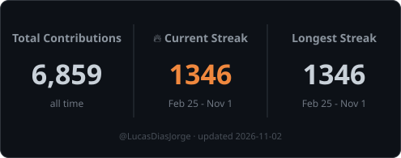

# Lucas Dias Jorge

**Backend-focused Full-Stack Developer · .NET & Java/Spring · Vue · IoT/RFID · C/C++/Rust**

Building APIs, integrations, and device-facing software — from web interfaces to embedded protocols.

  

  Streak card is self-hosted — generated daily by a <a href="./.github/workflows/update-streak.yml">GitHub Action</a> from the GraphQL contributions API, no third-party service involved.

## 👋 About me

Full-stack developer with a backend-first focus. My projects span **C#/.NET and Java/Spring APIs**, **TypeScript/JavaScript interfaces with Vue**, and distributed services built around Kafka/RabbitMQ, REST/gRPC, and JWT/Keycloak authentication.

I also work close to hardware and protocols: **RFID reader integrations**, ESP32/ESP8266, MQTT, LoRa, Modbus, and low-level/concurrent programming in **C, C++ and Rust**. Other project areas include data processing, computer vision, local and on-device AI, and mobile/desktop apps with Flutter, Android, and Qt.

- 🧱 Backend-first, full-stack by choice — I take features from domain/API design through persistence, integrations, and UI.
- 🔌 I enjoy connecting software with hardware and external systems: reader workflows, event messaging, sockets, and embedded protocols.
- 🧪 I value maintainable architecture and testing, and use Docker, Linux, and deployment automation to run projects reliably.

## 🔧 Tech stack

| Area | Stack |
| --- | --- |
| **Back-end & APIs** | C# · ASP.NET Core (.NET 8–10) · EF Core · Dapper · Java 17/21 · Spring Boot 3/4 · Spring Security · JPA/Hibernate · Rust (Actix, Axum) · Node.js · REST · gRPC · OpenAPI |
| **Distributed systems** | Microservices · Spring Cloud (Eureka, Gateway, Config) · Kafka · RabbitMQ · Saga orchestration · JWT/OAuth2/Keycloak · background workers · SSE · WebSockets · resilience (Polly, Resilience4j) · blockchain/ledger experiments |
| **Front-end** | TypeScript · JavaScript · Vue 3 · Pinia · Vue Router · Vite · Vuetify · Zod · Vitest/Jest |
| **IoT & RFID** | Impinj R700/Octane SDK · EPC encoding · RFID integrations · ESP32/ESP8266 · Arduino/PlatformIO · MQTT · LoRa · Modbus |
| **Systems & embedded** | C · C++ · Rust · ARM cross-compilation · concurrency (pthreads, OpenMP) · shared memory/IPC · sockets · Make/CMake |
| **Data & storage** | PostgreSQL · MySQL · SQL Server · SQLite · Redis · ScyllaDB · MongoDB · Python scripting · data processing |
| **AI & vision** | OpenCV · embeddings & semantic search (Semantic Kernel, pgvector) · local LLMs (Ollama) · on-device AI (OpenVINO/NPU) · speech-to-text (Whisper) · GitHub Copilot SDK |
| **Architecture & quality** | Clean/Hexagonal Architecture · DDD · CQRS · SOLID · design patterns · TDD · xUnit · JUnit/Mockito · integration & load testing (k6) |
| **DevOps & operations** | Docker/Compose · Linux/Bash · Nginx · GitHub Actions · deployment scripts · observability (Actuator, Micrometer/Prometheus) · logging (Serilog, SLF4J) · caching (Redis, Spring Cache) · secrets via env/user-secrets |
